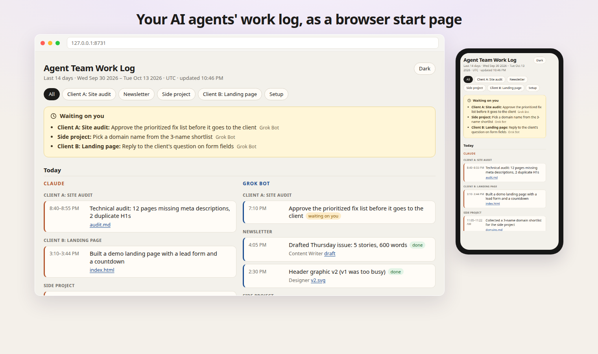

# Work Log

A local start page for what your AI agents did. Each source gets a column. Inside a column, work is grouped by project, with links to the files those agents wrote and a list of anything waiting on you.

The page is a static file. The tool that builds it is Python 3.9+ and the standard library. It does not phone home.



## Quick start

```bash
python3 -m worklog demo --serve
```

Open [http://127.0.0.1:8731/](http://127.0.0.1:8731/). The demo is fictional: Client A, Client B, a newsletter, and a side project. It does not read your home directory.

`demo` rewrites the sample with today's dates, builds `demo/site/index.html`, and serves it. Leave the command running and refresh the tab after the next build.

To use your own logs, copy the example and point it at your agent directories:

```bash
cp worklog.example.toml worklog.toml
python3 -m worklog build
python3 -m worklog serve
```

## What the page shows

- A column for each source you configure. Claude Code and a JSON log are the two columns in the demo. Columns stack on a narrow screen.
- Project chips. Choose one to hide the others. The choice is made in the browser; the file already contains only redacted summaries.
- **Waiting on you**, for entries whose status is waiting. The heading is not a count of everything in the log.
- Day groups, newest first, with **Today** and **Yesterday** labeled in the machine's timezone.
- Status badges (`done`, `waiting on you`, `in progress`), the agent or role, and links to deliverables.
- A light theme and a dark theme. The first paint follows the system setting. The button on the page remembers your choice in `localStorage`.

There is no total of sessions, files, or entries at the top.

## Commands

| Command | What it does |
| --- | --- |
| `python3 -m worklog demo --serve` | Write the fictional demo, build it, and serve it |
| `python3 -m worklog extract -c worklog.toml` | Read sources and write a redacted `log.json` |
| `python3 -m worklog build -c worklog.toml` | Extract, copy linked deliverables, write `index.html` |
| `python3 -m worklog serve -c worklog.toml` | Serve the built site on `127.0.0.1` |
| `python3 -m worklog serve --rebuild` | Rebuild, then serve |

`serve` binds to loopback only. `127.0.0.1`, `localhost`, and `::1` are accepted. Any other host is refused. If `index.html` is missing, `serve` builds it first.

Add `-c path/to/worklog.toml` (or `.json`) when the config is not in the current directory. Relative paths in the config are resolved from the config file's directory.

## Config

TOML and JSON use the same keys. The TOML reader covers the example file: strings, integers, booleans, arrays, tables, and arrays of tables. On Python 3.11+ you can still use this file; the project does not depend on `tomllib`.

```toml
title = "Work Log"
days = 14                  # calendar days, including today, from 1 to 366
output = "site"            # where index.html is written
deliverables = "deliverables"
host = "127.0.0.1"
port = 8731

# Case-insensitive regular expressions. A match drops the whole entry.
exclude = ["private-archive"]

[project_names]
client-a-site-audit = "Client A: Site audit"

[[sources]]
id = "claude"
label = "Claude"
kind = "claude-code"       # claude-code, json, or claude-desktop
paths = ["~/.claude", "~/.claude-work"]
enabled = true
```

`kind = "jsonl"` is an alias of `json`.

Omit `paths` on a Claude Code source to use `~/.claude` and `~/.claude-work`. Omit them on a Claude desktop source to use `~/Library/Application Support/Claude` on macOS. On other systems that default is skipped unless you set an explicit path (a fixture directory, for tests).

`project_names` maps a folder name, such as the last part of a session's working directory, to the label on the page. Chip order follows this table, then any other projects alphabetically.

## A log any agent can append

Point a `json` source at a file or a directory of `*.json` and `*.jsonl` files. Unknown fields are ignored, so a noisy log cannot leak extra text onto the page.

```json
{"timestamp":"2026-10-13T16:05:00-04:00","project":"Newsletter","summary":"Drafted Thursday issue: 5 stories, 600 words","status":"done","agent":"Content Writer","links":[{"label":"draft","href":"newsletter/draft.md"}]}
```

Also accepted: a JSON array, or `{"entries": [ ... ]}`. `summary` or `title` is the line on the card (trimmed to 100 characters). `time` plus `date` (`"4:05 PM"` and `"2026-10-13"`) works when you do not have a full timestamp. Status values `done`, `waiting on you`, and `in progress` (and a few aliases like `in_progress` and `blocked`) get the badges. Anything else is shown as a short plain badge, unless it looks like a secret, in which case the badge is dropped.

Append a line and rebuild:

```bash
echo '{"timestamp":"2026-10-13T18:00:00","project":"Side project","summary":"Renamed the draft","status":"done"}' >> logs/grok.jsonl
python3 -m worklog build
```

## Claude Code

`kind = "claude-code"` reads `<dir>/projects/*/*.jsonl`, one file per top-level session. Files deeper than that are sub-agent transcripts and are ignored. Several config directories can share one column. The demo uses `fixtures/claude` and `fixtures/claude-work`; a second directory shows a short note such as `work` on its cards.

For each session the adapter keeps:

- a title of at most 100 characters (a custom title if the session has one, otherwise the first real user message, with tagged system wrappers removed)
- the project (the folder name of `cwd`, unless `project_names` renames it)
- start and end timestamps
- up to 25 paths of files written or edited (`Write`, `Edit`, `MultiEdit`, `NotebookEdit`, `str_replace`, and the older `str_replace_based_edit_tool`)

It does not keep the message body, the patch, or the contents of a written file. Paths are shortened against the session directory, then against your home directory (`~/...`).

## Claude desktop

`kind = "claude-desktop"` is optional and reads Claude desktop session metadata on macOS: the title, folders, and timestamps under `~/Library/Application Support/Claude`. For a cowork session it streams that session's own transcript only to collect written paths. The initial message is checked against your exclude patterns and then discarded. It is not stored.

Sessions already imported from Claude Code are not listed twice. Set `enabled = false` to turn the source off. The example config ships that way.

## Deliverables

Set `deliverables` to a directory of files you are willing to publish on the local site. A relative link such as `newsletter/draft.md` is copied into the output folder when that file exists under the deliverables root. A Claude session that wrote `reports/audit.md` becomes a link when the same relative path exists there.

Links outside that directory are not copied. `javascript:`, `data:`, `file:`, absolute paths, and `..` segments are dropped. `http` and `https` links are left as external links and are not fetched.

## Browser extension

`extension/` is a Manifest V3 new-tab override for Chrome and Firefox. It opens the local server (default `http://127.0.0.1:8731/`). The options page only accepts `127.0.0.1` and `localhost` URLs.

Chrome: go to `chrome://extensions`, turn on Developer mode, choose **Load unpacked**, and select the `extension` folder.

Firefox: go to `about:debugging#/runtime/this-firefox`, choose **Load Temporary Add-on**, and select `extension/manifest.json`. The extension id is `worklog@localhost`.

If the server is down, the new tab tells you to start it instead of failing silently.

## Privacy

Nothing in this project opens a socket except the local server, and that server refuses to bind to anything but loopback. There is no analytics, no remote font, and no remote script. The generated page sends `no-referrer` and a content security policy that blocks network loads.

Extractors write a redacted summary. They do not write raw transcripts. Before a title, path, project, or link is saved, text that looks like a credential is replaced with `[redacted]`:

- private keys
- Stripe-style `sk_` / `pk_` / `rk_` keys
- GitHub tokens (`ghp_`, `github_pat_`, and the other `gh*_` forms)
- Slack `xox*` tokens
- AWS access key ids
- Google API keys and `ya29.` tokens
- JWTs
- bearer tokens
- passwords, API keys, and similar assignments
- URLs with a username and password
- long hex strings and long base64-looking tokens

Exclude patterns are case-insensitive regular expressions. If one matches the working directory, the title, the first message, or a written path, the whole session is dropped and its text is not written out. A bad regex is a config error, not a silent miss.

The demo transcript contains a marker string inside a tool body (`UNIQUE_TOOL_BODY_DO_NOT_PUBLISH_9f3c`) and a session whose path matches `private-archive`. The tests check that neither reaches `index.html` or `log.json`.

Paths outside your home directory are stored as given. Keep projects under your home folder if you do not want those absolute paths in `log.json`. The HTML page shows the shortened path, not the transcript.

Rebuild when you want a fresh page. A morning cron is enough:

```bash
python3 -m worklog build -c "$HOME/worklog.toml"
```

## Tests

```bash
python3 -m unittest discover -s tests -t .
```

The tests cover the redaction patterns, both config formats, the Claude Code and Claude desktop adapters, the JSON log, deliverable copying, the loopback server, and the demo pipeline.

## License

MIT. See [LICENSE](LICENSE).
